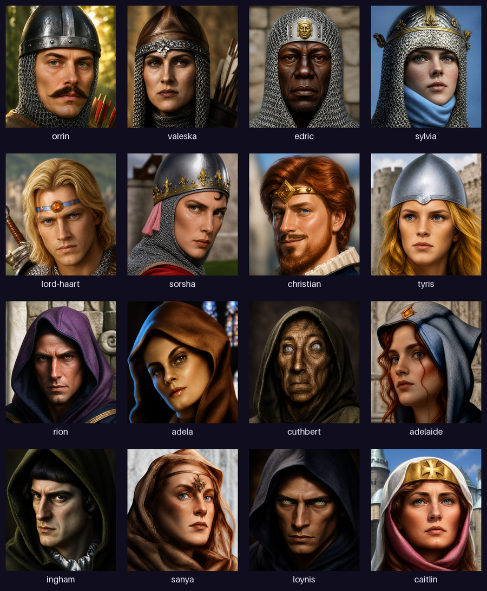
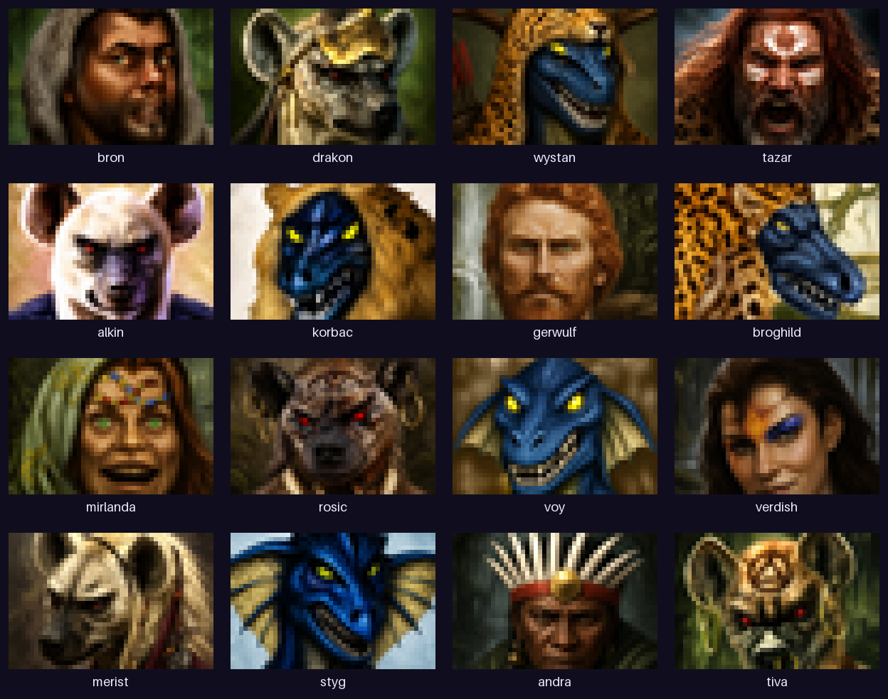
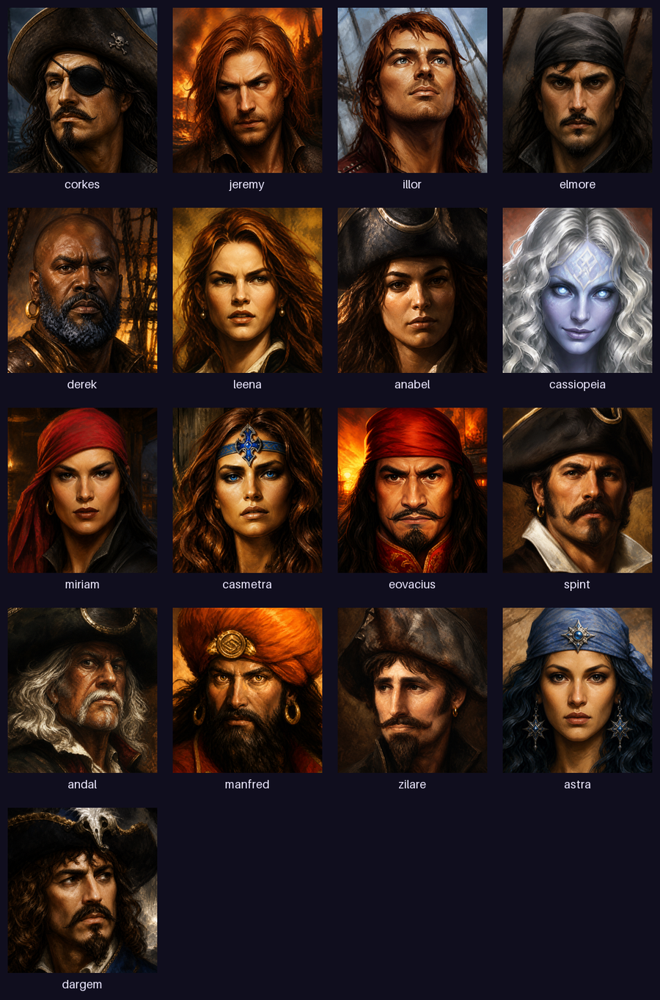
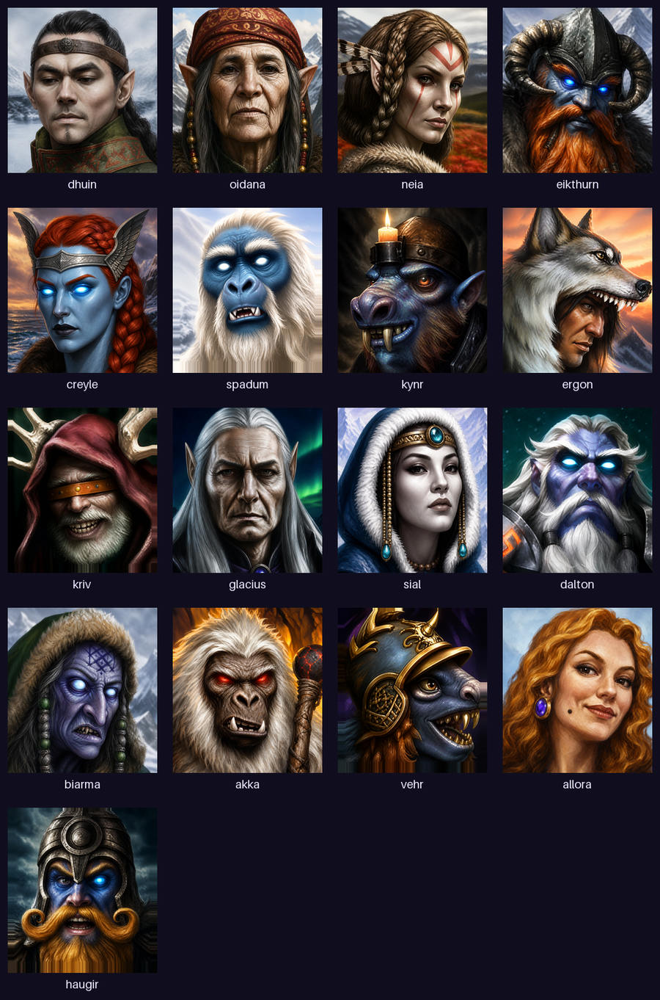

# Heroes III New Design — Portraits

206 refreshed hero portraits for [VCMI](https://vcmi.eu): AI-assisted reinterpretations of the classic
Heroes of Might and Magic III artwork, selected, cropped and packaged for the VCMI mod manager.
Visual refresh only — no gameplay, balance or text changes.

The repository is the mod: the root holds the parent `mod.json`, and `Mods/` contains 13 selectable
faction submods. It follows the same layout as mods hosted in the
[vcmi-mods organization](https://github.com/vcmi-mods), so it can be forked and served directly.

## What's inside

| Submod | Portraits | Enabled by default | Requires |
|---|---|---|---|
| Castle | 16 | yes | — |
| Rampart | 16 | yes | — |
| Tower | 16 | yes | — |
| Inferno | 16 | yes | — |
| Necropolis | 16 | yes | — |
| Dungeon | 16 | yes | — |
| Stronghold | 16 | yes | — |
| Fortress | 16 | yes | — |
| Conflux | 16 | yes | — |
| Special & campaign heroes | 12 | yes | — |
| Cove | 17 | no | `hota.cove` |
| Factory | 16 | no | `hota.factory` |
| Bulwark | 17 | no | `hota.bulwark` |

Every hero has a large and a small portrait at 1x, 2x, 3x and 4x. Small portraits use an exact
original-style 1-pixel border (template supplied by misiokles, see `docs/border-source.json`).

## Installation

**Via VCMI Launcher (recommended):** open *Mods → Mod Repository*, find
“Heroes III New Design Portraits”, install and enable it, then enable the submods you want.

**From a release zip:** download `heroes3-new-design-portraits-vcmi-1.7.zip` from
[Releases](../../releases), extract it into your `vcmi/Mods/` folder (or install the zip through the
launcher) and enable the mod and its submods.

Requires VCMI 1.7.0 or newer. The Cove, Factory and Bulwark submods additionally require the
corresponding HotA modules and stay disabled until those are present.

### Upgrading from the standalone v1 packs

The 13 standalone `heroes3-new-design-portraits-<faction>-v1` packs are superseded by this mod.
Uninstall or disable them before enabling the matching submods — conflicts are declared, so the
launcher will warn you.

### Compatibility

Base-faction submods replace the same portrait files as *Portraits Packs* and *Ensrick's Portrait
Pack*, so conflicts are declared against both. Pick one portrait set per faction.

## Browse before installing

The full gallery with side-by-side comparisons against the originals:
**https://heroes3-new-design.vercel.app/?lang=en**

## Credits & license

- Portrait artwork: AI-assisted reinterpretations produced and curated by the
  [Heroes III New Design](https://github.com/PeteNova/heroes3-new-design) project (PeteNova).
- Small-portrait border template: misiokles.
- Heroes of Might and Magic III and its original artwork are © New World Computing / Ubisoft.
  This is a non-commercial fan project, not affiliated with or endorsed by Ubisoft. It requires an
  installed copy of the original game.

Licensed under [CC BY-NC-SA 4.0](https://creativecommons.org/licenses/by-nc-sa/4.0/) — see
[LICENSE.md](LICENSE.md).

---

## Po polsku (skrót)

**Heroes III New Design — Portrety**: 206 odświeżonych portretów bohaterów dla VCMI. Jedna
instalacja, 13 włączanych osobno podmodyfikacji frakcyjnych (duże i małe portrety w skalach
1x–4x, z oryginalnym jednostrzałowym obramowaniem małych portretów). Tylko grafika — bez zmian
w rozgrywce.

**Instalacja:** VCMI Launcher → Mods → Mod Repository → „Heroes III New Design Portraits".
Wymagany VCMI 1.7.0+; podmody Cove, Factory i Bulwark wymagają odpowiednich modułów HotA
i domyślnie są wyłączone. Jeśli używałeś wcześniejszych pojedynczych paczek
`heroes3-new-design-portraits-<frakcja>-v1`, wyłącz je przed włączeniem odpowiadających podmodyfikacji.

Pełna galeria z porównaniami z oryginałem: https://heroes3-new-design.vercel.app/?lang=pl
